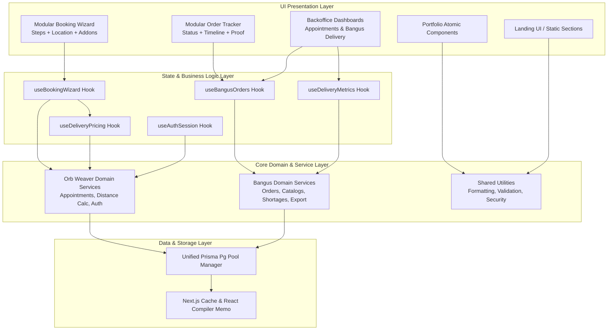
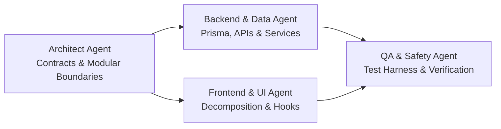

# System Architecture & Refactoring Blueprint

## 1. Current Architecture Overview

The system operates as a unified Next.js 15 application utilizing App Router conventions with React 19, TypeScript, and Prisma ORM against PostgreSQL.

```
makienaut-portfolio/
├── prisma/
│   ├── schema.prisma                  # Unified PostgreSQL Schema (Orb Weaver + Bangus)
│   └── migrations/                    # 12 historical migrations
├── src/
│   ├── app/                           # App Router routes and API handlers
│   │   ├── page.tsx                   # Portfolio root page
│   │   ├── vroombroom/                # VroomBroom customer & backoffice routes
│   │   │   ├── page.tsx               # Monolithic landing page (628 LOC)
│   │   │   ├── book/                  # Booking page & appointment form
│   │   │   ├── orders/                # Order tracking interface
│   │   │   └── backoffice/            # Protected admin & supplier interfaces
│   │   └── api/
│   │       ├── orb-weaver/            # Appointments, lookup, sessions
│   │       └── bangus/                # Delivery tables, orders, products, metrics
│   ├── components/
│   │   ├── atoms/, molecules/, organisms/, templates/  # Atomic portfolio components
│   │   ├── orb-weaver/                # Monolithic VroomBroom components
│   │   └── bangus/                    # Monolithic Bangus backoffice components
│   ├── lib/
│   │   ├── orb-weaver/                # DB connection, auth, pricing, session
│   │   └── bangus/                    # Orders, metrics, validation, markdown export
│   ├── types/                         # TypeScript contract definitions
│   └── styles/                        # Tailwind configurations and fonts
```

### 1.1 Data Model Architecture
- **Orb Weaver Domain**:
  - `OrbWeaverUser`: Authentication credentials, scrypt password hashes, and roles (`ADMIN`, `SUPPLIER`, `USER`).
  - `OrbWeaverAppointment`: Service appointments, delivery parameters, GPS coordinates, JSON add-ons, pricing breakdown, status enum (`PENDING` -> `CONFIRMED` -> `IN_PROGRESS` -> `READY` -> `COMPLETED` / `CANCELLED`).
  - `OrbWeaverLoginAttempt`: IP/fingerprint-based brute-force throttling records.
- **Bangus Domain**:
  - `BangusProductCategory` & `BangusProduct`: Catalog, retail/supplier unit pricing, packaging units.
  - `BangusDeliveryTable`: Daily wholesale delivery groupings.
  - `BangusOrder`, `BangusOrderItem`, `BangusOrderItemShortage`: Wholesale order lines, delivery statuses, repacking indicators, shortage adjustments.

---

## 2. Target Architecture

The target architecture refactors monolithic components into cohesive, single-responsibility modules, separates domain state management into dedicated hooks, dynamically splits client-side code, and establishes a robust test harness.



---

## 3. Specialized Multi-Agent Workforce

To execute the refactoring efficiently with precision, tasks are partitioned across four specialized agent roles:



### Agent Roles & Responsibilities

1. **Architecture & Boundaries Specialist (`Architect Agent`)**
   - **Focus**: Modular contract boundaries, type safety, directory conventions, and shared schemas.
   - **Scope**:
     - Establishes modular interfaces between domains (Portfolio vs. Orb Weaver vs. Bangus).
     - Standardizes error response types and API payloads.
     - Enforces clear layer boundaries (UI -> Custom Hooks -> Domain Service -> Data Layer).

2. **Frontend & Performance Specialist (`Frontend Agent`)**
   - **Focus**: Component decomposition, React 19 performance patterns, custom hooks, and bundle splitting.
   - **Scope**:
     - Decomposes mega-components (`OrdersTab`, `AppointmentForm`, `BackofficeTicketModal`, `OrderTracker`, `BangusDashboard`).
     - Extracts state machines into custom hooks (`useBookingWizard`, `useOrderManagement`, `useDeliveryMetrics`).
     - Implements dynamic imports for `leaflet` and complex modal dialogs.
     - Minimizes unnecessary client re-renders and isolates client boundaries.

3. **Backend & Data Specialist (`Backend Agent`)**
   - **Focus**: Prisma queries, connection pooling, validation logic, and API efficiency.
   - **Scope**:
     - Optimizes `src/lib/orb-weaver/database.ts` connection adapter lifecycle.
     - Decouples intertwined database lookup routines and improves error handling.
     - Extracts validation and calculation pure functions (distance pricing, shortage reconciliation).

4. **QA & Verification Specialist (`QA Agent`)**
   - **Focus**: Automated testing, regression safety, test mocks, and validation pipelines.
   - **Scope**:
     - Installs and configures `vitest`, `@testing-library/react`, and jsdom.
     - Adds unit tests for critical business calculators (delivery fees, pricing subtotal, order shortage calculations).
     - Validates end-to-end type check (`npx tsc --noEmit`) and linting (`npm run lint`).

---

## 4. Phased Execution Roadmap

The refactoring is executed across 5 progressive, self-contained phases. Each phase is verified before advancing to the next.

### Phase 1: Test & Safety Harness Setup
- Install Vitest and React Testing Library dev dependencies.
- Configure `vitest.config.ts` with Next.js path aliases (`@/*`).
- Write unit test suites for pure business logic:
  - `src/lib/orb-weaver/delivery-pricing.ts` (pricing by distance, free delivery conditions).
  - `src/lib/bangus/product-metrics.ts` (metric totals, shortage deductions).
  - `src/lib/bangus/order-validation.ts` (order input sanitization).
- Ensure baseline CI command (`npm test`) passes.

### Phase 2: Domain Decoupling & Service Layer Extraction
- Separate database connection logic: cleanly decouple Orb Weaver and Bangus database client initialization without redundant instantiation.
- Standardize response formats and error envelopes across `/api/orb-weaver/*` and `/api/bangus/*`.
- Extract common helper utilities (currency formatting, date windows, input sanitize) into unified utility modules.

### Phase 3: Component Decomposition & Hook Extraction
- **VroomBroom Decomposition**:
  - Break `src/components/orb-weaver/AppointmentForm.tsx` (1,427 LOC) into:
    - `useBookingForm` hook (form state, step transitions, pricing sync).
    - `BookingCustomerStep.tsx`, `BookingServiceStep.tsx`, `BookingDeliveryStep.tsx`.
  - Break `src/components/orb-weaver/BackofficeTicketModal.tsx` (1,095 LOC) into sub-panels (Details, StatusTimeline, DeliveryPricing, ProofUpload).
  - Break `src/components/orb-weaver/OrderTracker.tsx` (883 LOC) into modular tracker cards.
- **Bangus Decomposition**:
  - Break `src/components/bangus/OrdersTab.tsx` (1,482 LOC) into:
    - `useBangusOrders` hook (order filtering, shortage tracking, modal toggles).
    - `OrderSummaryTable.tsx`, `OrderBatchActions.tsx`, `OrderShortageSummary.tsx`.
  - Break `src/components/bangus/BangusDashboard.tsx` (737 LOC) into modular tab controllers.

### Phase 4: Performance, Bundle & Code-Splitting Optimization
- Convert `leaflet` map loader into dynamic, lazy-loaded components with `next/dynamic` and `ssr: false` placeholders to avoid hydration overhead.
- Dynamically load heavy backoffice modals (`OrderFormModal`, `ProductFormModal`, `BackofficeTicketModal`) so they are fetched on user interaction rather than initial page load.
- Optimize icon imports from `react-icons` to minimize chunk sizes.

### Phase 5: Verification, Benchmarking & Documentation
- Execute full test suite (`npm test`), full typecheck (`npx tsc --noEmit`), and full lint (`npm run lint`).
- Execute production build (`npm run build`) and benchmark bundle sizes against pre-refactor metrics.
- Update repository documentation with architectural diagrams and component maps.
