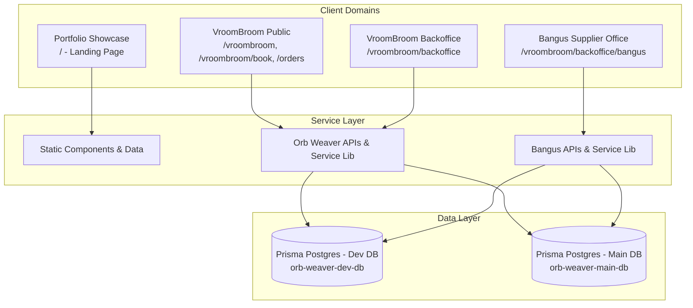

# System Context & Background

## Executive Summary

The **makienaut-portfolio** repository hosts a multi-faceted web platform built on **Next.js 15 (App Router)**, **React 19**, **TypeScript**, **Tailwind CSS**, and **Prisma ORM**. 

Originally created as an engineering portfolio, the codebase has expanded into a unified multi-application monorepo hosting three distinct domains:
1. **Portfolio Showcase**: Makienaut's personal software engineering portfolio and project showcase.
2. **VroomBroom (Orb Weaver)**: An on-demand motorcycle helmet cleaning, sanitizing, and delivery logistics service with appointment booking, distance-based pricing, and order tracking.
3. **Bangus Wholesale Supply Chain**: A back-office supplier management system for seafood/bangus wholesale orders, product catalogs, delivery tables, repack tracking, and shortage calculation.

While feature-rich and operational, rapid feature additions have led to significant maintenance overhead, oversized client components (some exceeding 1,400 lines), tightly coupled database connections, and an absence of automated regression testing.

---

## Business & Domain Context

### 1. Portfolio Showcase
- **Audience**: Prospective employers, clients, and technical collaborators.
- **Scope**: Static/SSG portfolio displaying biography, skill categories, featured case studies, experience timeline, and contact channels.
- **Key Characteristics**: Highly visual, responsive, zero database dependency.

### 2. VroomBroom (Orb Weaver)
- **Audience**: Motorcycle riders seeking specialized helmet cleaning services; administrators managing service orders.
- **Key Workflows**:
  - **Landing & Discovery (`/vroombroom`)**: Service offerings (Standard, Deep Clean, Restorative), add-ons, pricing structure, meetup spot map.
  - **Service Booking (`/vroombroom/book`)**: Multi-step booking form, schedule picker, meetup point vs. door-to-door delivery selection with Leaflet map coordinates, live pricing computation.
  - **Order Tracking (`/vroombroom/orders`)**: Public lookup by 8-character reference code or contact info, order status progression timeline, delivery proof viewer.
  - **Back-Office Management (`/vroombroom/backoffice`)**: Authenticated administrative dashboard, ticket management modal, appointment status updates, delivery distance pricing overrides, photo proof uploads.

### 3. Bangus Wholesale Management
- **Audience**: Internal wholesale seafood operations and suppliers.
- **Key Workflows**:
  - **Delivery Tables (`/vroombroom/backoffice/bangus`)**: Daily delivery runs grouping multiple wholesale orders.
  - **Order Processing**: Item selection, weight/pricing calculations, repacked indicators, product shortages tracking, markdown invoice export for clipboard sharing.
  - **Product Catalog**: SKU management, active/inactive toggles, category organization, delivery metrics aggregation.

---

## Technical Debt & Motivation for Refactoring

1. **Monolithic UI Component Files**:
   - `OrdersTab.tsx`: 1,482 lines
   - `AppointmentForm.tsx`: 1,427 lines
   - `BackofficeTicketModal.tsx`: 1,095 lines
   - `OrderTracker.tsx`: 883 lines
   - `BangusDashboard.tsx`: 737 lines
   - `AppointmentsDashboard.tsx`: 649 lines
   - `vroombroom/page.tsx`: 628 lines
   - `OrderDetailsEditor.tsx`: 588 lines
   
   These giant files combine UI layout, inline styling, complex domain business rules, network calls, state management, modal controllers, and form validations in single files. This creates high cognitive load, frequent merge conflicts, and sluggish browser rendering due to broad re-render scopes.

2. **Heavy Client-Side Bundles**:
   - Leaflet is bundled directly into customer client components without dynamic chunk isolation.
   - `react-icons` icons imported across hundreds of UI elements without optimized barrel-file handling.
   - Absence of dynamic code splitting on complex modal dialogs.

3. **Coupled Database & Auth Configuration**:
   - `src/lib/orb-weaver/database.ts` manages connection fallbacks for both Orb Weaver and Bangus using dual client instances with manual environment fallbacks.
   - Session authentication (`src/lib/orb-weaver/session.ts`) and middleware route protection are tightly bound to VroomBroom URL schemas while routing suppliers to Bangus.

4. **Zero Automated Regression Testing**:
   - No test runner (Vitest or Jest) exists.
   - Critical business workflows (appointment pricing calculation, shortage calculations, auth tokens, session cookies) have no automated unit or integration tests.

---

## Refactoring Objectives

- **Enhance Runtime Efficiency**: Decompose giant components to reduce DOM nodes, unnecessary re-renders, and hydration delays.
- **Optimize Bundle Size**: Dynamically import heavy libraries (e.g. Leaflet) and isolate administrative back-office code from public routes.
- **Improve Maintainability & Readability**: Extract custom hooks for data fetching, filtering, and form state; encapsulate modals into self-contained sub-components.
- **Establish Safety & Quality Harness**: Introduce unit and integration tests using modern testing tools (Vitest + React Testing Library).
- **Execution via Specialized Agents**: Leverage focused subagents (Architecture, Frontend/Hooks, Backend/Data, QA) operating in phased sprints.
